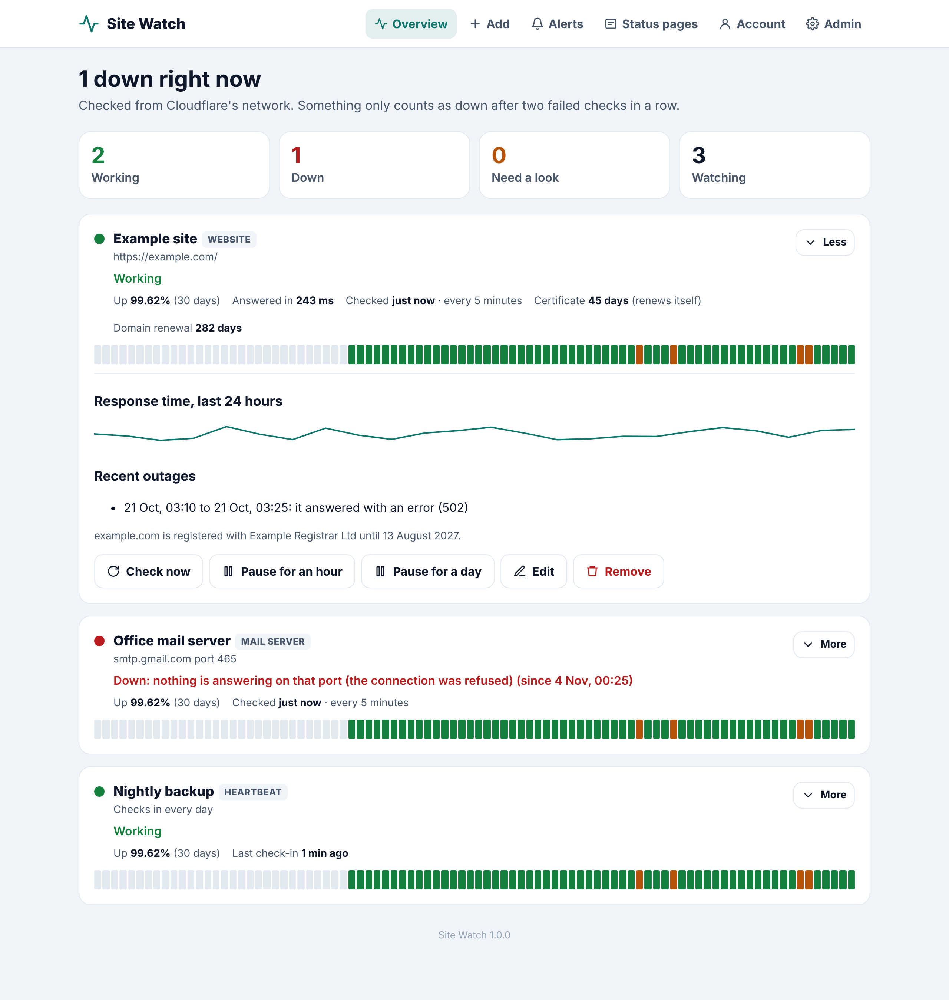
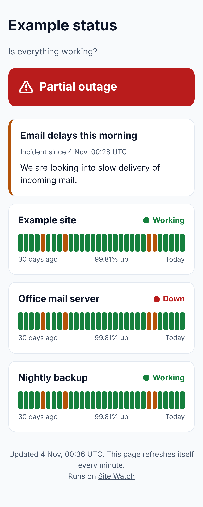
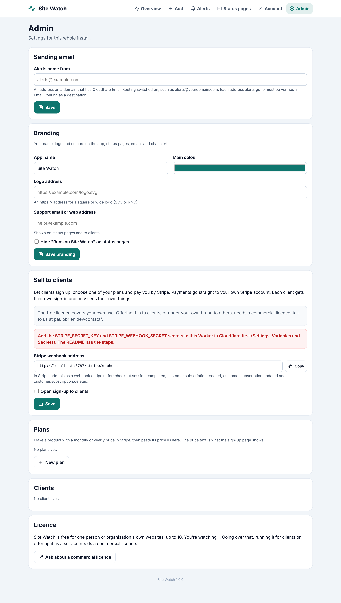

<div align="center">
  <h1>Site Watch</h1>
  <p><strong>Watch your websites, mail servers and scheduled jobs from your own Cloudflare account.</strong><br>
  Alerts by email, Slack, Teams, Google Chat, Discord or webhook, plus public status pages.</p>
  <p><a href="https://paulobrien.dev/watch/">Website</a> · <a href="#install">Install</a> · <a href="https://github.com/pobren/site-watch/releases">Releases</a> · <a href="https://github.com/pobren/site-watch/issues">Report a bug</a></p>
</div>

Site Watch runs in your own Cloudflare account, on Cloudflare's free plan. Your list of websites, their history and your alerts stay there, and nothing depends on anyone else to keep running.

**Free for personal and small business use, source available.** See [Licence](#licence) below.



## What it watches

- **Websites.** Every 1 to 60 minutes. Down after two failed checks in a row, so one slow answer doesn't wake you. Optional rules: words the page must or mustn't contain, the status code, and a time limit.
- **Certificates.** Looked up once a day in the public Certificate Transparency logs. Reminders 14, 7 and 1 days before a certificate runs out, or only when a self-renewing one (Let's Encrypt, Cloudflare) is late renewing.
- **Domain renewals.** The registration date from the registry, with reminders 30, 7 and 1 days before.
- **APIs.** Your own method (GET, POST, PUT, PATCH, DELETE or HEAD), headers and body, then the status, words, time limit and a JSON value it must equal (such as `status` equals `ok`). Anything under 400 counts as working unless you set a status. Header values are hidden once saved.
- **DNS records.** A, AAAA, CNAME, MX, TXT, NS or CAA, looked up through Cloudflare's 1.1.1.1. Down when the records vanish or the name stops existing, or when they stop including the value you give (an address or mail server). Every 5 minutes or slower.
- **Mail servers.** Checks your server answers and offers encryption, for sending (587, 465) and reading (993, 143, 995, 110). It never signs in. Port 25 can't be checked: Cloudflare doesn't allow it.
- **Ports.** Any other server and port, such as SSH or a database.
- **Heartbeats.** Your backup or scheduled job visits its own address each time it runs. If it doesn't check in on time, you hear about it.

When something keeps going up and down, you get one alert saying so instead of dozens. A daily cap you choose is the safety net.

## Status pages

Public pages showing whether things are working, 90 days of daily bars and your notices. Put one on its own domain, such as status.example.com. Only the names you choose are shown, never server addresses.



## API, webhooks and AI connector

Full guide: [paulobrien.dev/watch/api](https://paulobrien.dev/watch/api/). The same rules as Mail App, ReaderCount and DMARC Reports.

**API.** Make a key on the **Account** tab (Read only, or Read and change). It's shown once. Send it in a header:

```sh
curl https://YOUR-SITE-WATCH-ADDRESS/api/v1/monitors \
  -H "Authorization: Bearer watch_..."
```

| Request | What it does |
| --- | --- |
| `GET /api/v1/monitors` | Everything you watch: status, uptime, response time, certificate and domain renewal |
| `GET /api/v1/monitors/{id}` | One of them, with its last 10 outages |
| `POST /api/v1/monitors` | Start watching something (same fields as the Add tab) |
| `POST /api/v1/monitors/{id}/check`, `/pause`, `/resume` | Check now, pause for `{"minutes": 60}`, or start again |
| `DELETE /api/v1/monitors/{id}` | Stop watching it |
| `GET /api/v1/alerts` | The latest alerts |
| `GET /api/v1/pages` | Your status pages and their notices |
| `POST /api/v1/pages/{id}/notices` | Post a notice: `{"title": "...", "body": "...", "impact": "minor"}` |
| `POST /api/v1/notices/{id}/resolve` | Mark a notice resolved |

Errors come back as `{"error": "...", "docs": "..."}`. Each key can make 60 requests a minute. Keep keys on your server, never in a web page.

**Webhooks.** Add **Your own webhook** on the **Alerts** tab. Each alert is a JSON `POST` with a `type` (`monitor.down`, `monitor.up`, `monitor.flapping`, `monitor.blocked`, `monitor.cert`, `cert.expiring`, `domain.expiring`), the `monitor` it's about, and a `Site-Watch-Signature: t=...,v1=...` header: HMAC-SHA256 of `<t>.<body>` with the webhook's `whsec_` secret, the same as Mail App.

**AI connector.** In Claude, open **Settings › Connectors › Add custom connector** and paste `https://YOUR-SITE-WATCH-ADDRESS/mcp`. Claude asks you to sign in once, and can only read. Apps that let you add a header can send an API key instead.

## Your brand, and selling to clients

On the Admin tab you can change the name, logo, colour and support address used everywhere: the app, status pages, emails and chat alerts.

You can also switch on **Sell to clients**: clients sign up, pick one of your plans and pay you with Stripe Checkout, using your own Stripe account. Each client gets their own sign-in and only sees their own things. Stripe handles cards, receipts, changing plan and cancelling; a client's checks only run while their subscription is paid. Using Site Watch this way needs a [commercial licence](#licence).

## What you need

- A Cloudflare account. The free plan is fine.
- For email alerts: a domain on that account with Email Routing switched on (see [Email alerts](#email-alerts)). Chat and webhook alerts need nothing extra.

## Install

All three ways install into your own Cloudflare account. Updating later keeps everything you've set up.

### 1. The installer (recommended)

You need [Node.js](https://nodejs.org) 20 or later.

```sh
npx @mrpwob/site-watch setup
```

It uses Wrangler, Cloudflare's own tool, which asks you to sign in to Cloudflare in your browser. It makes the database, installs Site Watch and gives you a one-time link to make your account. Run the same command again to update.

### 2. Deploy to Cloudflare

[](https://deploy.workers.cloudflare.com/?url=https://github.com/pobren/site-watch)

The button copies Site Watch to your GitHub account, makes its database and installs it. It asks for one thing:

- **SETUP_TOKEN:** a long secret code you make up. Replace the example: it won't work, so set-up stays locked until you choose your own.

When it's deployed, open `https://<your Site Watch address>/setup?code=<your code>` to make your account. Only someone with the code can. The same link resets your password if you ever forget it.

To update later, use **Sync fork** on your GitHub copy and Cloudflare rebuilds it.

### 3. From the code

```sh
git clone https://github.com/pobren/site-watch.git
cd site-watch
npm install
npx wrangler secret put SETUP_TOKEN   # a long secret code you make up
npm run deploy
```

To try it on your computer first: copy `.dev.vars.example` to `.dev.vars`, choose a code, then `npm run dev`.

## Email alerts

Cloudflare sends the emails through Email Routing, free.

1. In Cloudflare, open one of your domains, then **Email › Email Routing**, and switch it on.
2. Under **Destination addresses**, add the address alerts should go to and click the link Cloudflare emails you.
3. In Site Watch, open **Admin › Sending email** and enter an address on that domain for alerts to come from, such as `alerts@yourdomain.com`.
4. Open **Alerts** and send yourself a test.

Each address alerts go to must be verified in step 2. Password reset emails for clients need this too.

## Robot check (optional)

Sign-in, set-up, forgotten password and client sign-up can use [Cloudflare Turnstile](https://developers.cloudflare.com/turnstile/), Cloudflare's free check that a person is using the form. Most people see nothing; a few are asked to tick a box. Wrong passwords are already limited, so this is an extra layer.

1. In Cloudflare, open **Turnstile** and add a widget. Use your Site Watch address as its hostname and choose **Managed**.
2. On the Worker, open **Settings › Variables and Secrets** and add two secrets: `TURNSTILE_SITE_KEY` (the site key) and `TURNSTILE_SECRET` (the secret key). Add both as secrets, so updates keep them. From the code: `npx wrangler secret put TURNSTILE_SITE_KEY` and `npx wrangler secret put TURNSTILE_SECRET`.

It switches on once both are there. Remove either one to switch it off.

## Selling to clients

1. In Stripe, make a product for each plan with a monthly or yearly price.
2. In Cloudflare, open **Workers & Pages › site-watch › Settings › Variables and Secrets** and add two secrets: `STRIPE_SECRET_KEY` (your secret key) and `STRIPE_WEBHOOK_SECRET` (from step 3).
3. In Stripe, add a webhook endpoint at `https://<your Site Watch address>/stripe/webhook` for `checkout.session.completed`, `customer.subscription.created`, `customer.subscription.updated` and `customer.subscription.deleted`. Copy its signing secret into step 2.
4. In Site Watch, open **Admin**, add your plans with their Stripe price IDs, and tick **Open sign-up to clients**. Your sign-up page is `/signup`.
5. In Stripe's settings, switch on the customer portal and email receipts.

**Let Stripe handle tax (optional).** With [Stripe Managed Payments](https://docs.stripe.com/payments/managed-payments), Stripe sells your plans as merchant of record: it works out, collects and pays sales tax and VAT around the world and handles fraud and disputes, for an extra fee on each payment. Switch it on in Stripe, give each product a tax code labelled *Eligible for Managed Payments*, then add a variable `STRIPE_MANAGED_PAYMENTS` set to `on` to the Worker. Only new subscriptions use it.



### A free plan

Tick **Free plan** on a plan and it needs no Stripe price. People who choose it confirm their email address, then their checks start, so email must be set up (see [Email alerts](#email-alerts)). To email any address, not only verified ones, onboard your domain in **Email Service › Email Sending** in Cloudflare (Workers Paid plan). When someone's paid subscription ends they drop back to the free plan, and anything over its limits is paused rather than deleted.

Each plan can also cap alerts a day and choose where alerts can go: email only, email and browser alerts, or every channel. A link to `/signup?plan=pro&yearly=1` opens sign-up with that plan chosen.

## Browser alerts

On the **Alerts** tab, **Turn on alerts on this device** makes alerts pop up on that computer or phone, even with the page closed. Each browser is turned on separately and shows in the channel list, where you can test or remove it. On iPhone and iPad, add the site to the Home Screen first (Share, then Add to Home Screen) and turn alerts on from there.

There's nothing to set up: the first time someone turns alerts on, Site Watch makes its own signing keys and keeps them in the database. Alerts are encrypted for each browser, so the push services (Google, Apple, Mozilla, Microsoft) can't read them.

## Text and WhatsApp alerts

Site Watch can send the urgent alerts (down, and back up) by text message and WhatsApp, through your own [Twilio](https://www.twilio.com/try-twilio) account. You pay Twilio for each message, so it's off until you add the secrets below, and there are limits on every account.

1. Make a Twilio account and upgrade it (the trial can only text phones you've verified yourself). Add some credit and leave auto recharge off.
2. **Text messages:** for the UK and most of Europe, texts can come from a name of up to 11 letters (such as `SitePatrol`) instead of a number. For US and Canadian phones you need a verified toll free or 10DLC number of your own.
3. **WhatsApp:** connect a WhatsApp sender in the Twilio console (Messaging, Senders, WhatsApp senders). Meta checks your business first. Then make three templates in Twilio's Content Template Builder and send them to Meta for approval, in the **Utility** category (the code one as **Authentication**). Keep them plain: anything that reads like an offer gets charged as marketing. For example:
   - Down: `Alert: {{1}} stopped working at about {{2}}. We'll message you again when it's back. Open {{3}} for details.`
   - Back up: `Good news: {{1}} is working again. Open {{2}} for details.`
   - Code: `{{1}} is your verification code.`
4. On the Worker, open **Settings › Variables and Secrets** and add these as secrets:
   - `TWILIO_ACCOUNT_SID` and `TWILIO_AUTH_TOKEN` (Twilio console, Account info)
   - `TWILIO_SMS_FROM`: the sender name or number for texts (leave it out for WhatsApp only)
   - `TWILIO_SMS_FROM_US`: your US number for texts to +1 phones (optional)
   - `TWILIO_WHATSAPP_FROM`: your WhatsApp number, such as `+447700900123`
   - `TWILIO_WA_DOWN`, `TWILIO_WA_UP` and `TWILIO_WA_CODE`: the three templates' Content SIDs (they start `HX`)
5. Optional variables: `PHONE_COUNTRIES` (calling codes phones may be in, default `44,1`) and `PHONE_DAILY_MAX` (most phone messages a day for the whole install, default `250`).

Your own account has no monthly limit. For clients, set **Text and WhatsApp alerts a month** on each plan (0 leaves them off), and optionally add **Top ups** on the Admin tab: one off Stripe prices for extra alerts, which last a year. Each phone is confirmed with a six digit code before it gets anything; alerts made in the same run go as one message per phone; each account sends 30 a day at most.

## Apps on phones and computers

Apps (such as the Site Patrol app for iPhone, iPad and Mac) use the same API as the website. People sign in on the app with their email address and password, or with **Sign in on your phone** on the **Account** tab, which shows a QR code that works once, for 5 minutes. Each app shows on the Account tab, where it can be signed out. **Sign out everywhere** and a new password sign apps out too.

The Account tab also has **Delete my account** for clients, which deletes everything in the account and cancels any Stripe subscription.

### App alerts

Alerts in an app go through Apple's push service, signed with the key of the Apple Developer account that publishes the app. Add four secrets to the Worker:

| Secret | What it is |
| --- | --- |
| `APNS_KEY` | The text of the `.p8` key file (Certificates, Identifiers & Profiles, Keys, with Apple Push Notifications service on) |
| `APNS_KEY_ID` | The key's 10 character Key ID |
| `APNS_TEAM_ID` | Your 10 character Team ID |
| `APNS_TOPIC` | The app's bundle ID |

Down alerts are Time Sensitive, so they can come through Focus if the person allows it. With `APNS_TEAM_ID` and `APNS_TOPIC` set, Site Watch also serves `/.well-known/apple-app-site-association`, so a phone's camera opens the app from the QR code.

## Lots of websites

On its own, Site Watch checks about 40 things a minute, which is plenty for one business. For thousands, add a Cloudflare Queue (Workers Paid plan) and the cron hands checks out in batches:

```jsonc
"queues": {
	"producers": [{ "binding": "CHECKS", "queue": "site-watch-checks" }],
	"consumers": [{ "queue": "site-watch-checks", "max_batch_size": 5, "max_batch_timeout": 1 }]
}
```

Make the queue first with `npx wrangler queues create site-watch-checks`. The Admin tab says when checks are running through it.

## Second opinions from other regions

Checks run from Cloudflare's network, wherever your Worker happens to run. When something fails twice in a row, small helpers in other regions (west Europe and east US, or Asia Pacific when one can't answer) try it too, and the "down" alert only goes if at least one of them agrees. If they can all reach it, the dashboard says it's only failing from the main check and no alert is sent. The helpers are Durable Objects pinned to their region (`PROBES` in `wrangler.jsonc`) and only work while something is failing. Remove the `durable_objects` and `migrations` blocks to check from one place only.

## Your own home page and brand

Add a folder of static files to the Worker and people who aren't signed in see its `index.html` at `/`, with sign-in at `/signin` and sign-up at `/signup`. Other files (pricing, terms, privacy, icons) are served as they are. The Worker needs to run first, so it can tell who's signed in:

```jsonc
"assets": { "directory": "./public", "binding": "ASSETS", "run_worker_first": true }
```

To keep Site Watch's name out of places people outside the app can see, set these as plain variables on the Worker: `CHECK_AGENT` (the user agent websites see in their logs), `DOCS_URL` (the API guide link), `HOME_URL` and `APP_NAME` (what the AI connector calls itself).

## How it works

One Cloudflare Worker and one D1 database. Every minute the Worker checks whatever is due, a few at a time, from Cloudflare's network. All checks for an install come from that one place. Ten websites checked every five minutes fit easily in Cloudflare's free plan.

The checks visit your pages with the user agent `SiteWatch/1.0`. If a firewall or security plugin blocks Cloudflare's addresses, let that through.

## Licence

Site Watch is source available under the [Business Source License 1.1](LICENSE). In plain English:

- **Free** for one person or organisation's own websites, up to 10 (with their mail servers, ports and heartbeats).
- **Needs a commercial licence:** going over 10 websites, running it for clients or other people, or offering it as a hosted, managed or white-label service. [Talk to us](https://paulobrien.dev/contact/) (choose "Let's work together").
- Each version becomes Apache 2.0 four years after it's released.

There's no licence key and nothing in the app stops you. We trust you. The [LICENSE](LICENSE) file is the legal text.

## Help

Questions and bugs go to [GitHub issues](https://github.com/pobren/site-watch/issues). Please don't send personal details there.
